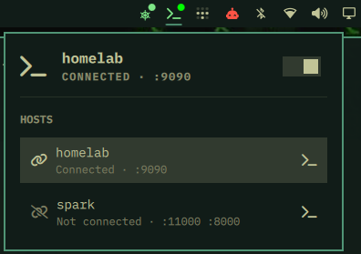

# SSH Host

A simple SSH visualization tool for the Omarchy bar. See configured SSH aliases,
background connection status, and configured local forwarding ports at a glance.
The panel can also start or stop a background connection or open an interactive
terminal session.



## Requirements

- Omarchy with Quickshell plugin support
- Python 3
- OpenSSH client (`ssh`)
- Explicit `Host` aliases in `~/.ssh/config` or static `Include` paths

## Install

Install the plugin from its public Git repository and enable it:

```sh
omarchy plugin add https://github.com/Arturo387/ssh-host.git --enable
```

## Use

Click the bar icon to open the host list. Select a host to view its status and
forwarding ports. Use the switch to start or stop a background connection, or
choose the terminal action to open an interactive session.

The optional `host` setting selects the initial alias. It defaults to an empty
value.

## Privacy and security

The plugin reads `~/.ssh/config` and discovers aliases in static `Include`
paths. OpenSSH resolves each alias's effective settings and handles SSH
connections. Host-dependent `Include` paths may not be discoverable.

The plugin does not store SSH credentials or send telemetry. SSH configuration
options, including proxy commands, retain their normal OpenSSH behavior. The
plugin runs with the user's permissions and is not sandboxed.

## Remove

Remove the installed plugin by its manifest ID, `arturo.ssh-host`:

```sh
omarchy plugin remove arturo.ssh-host
```
